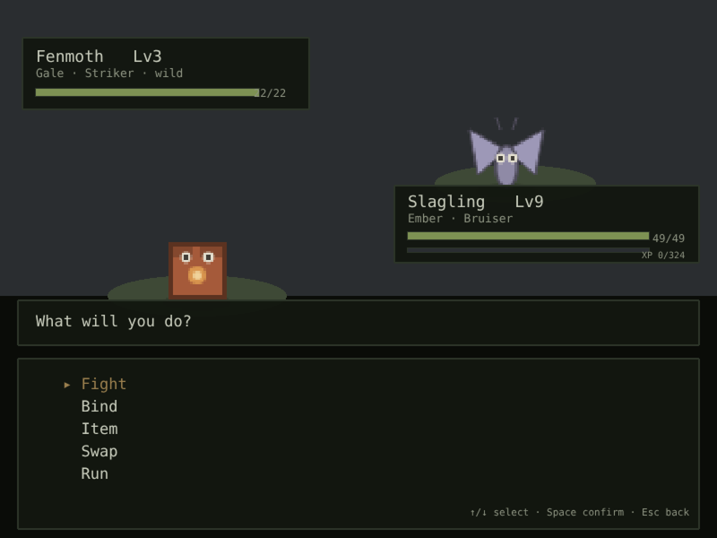
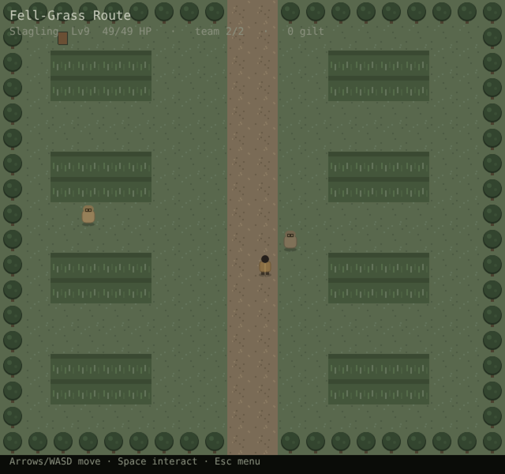
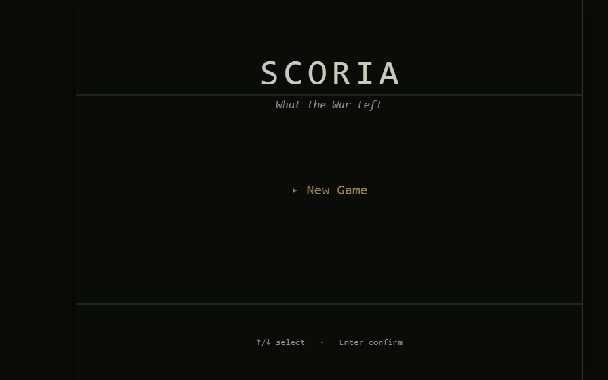
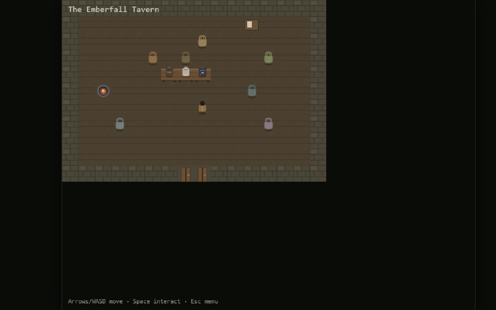
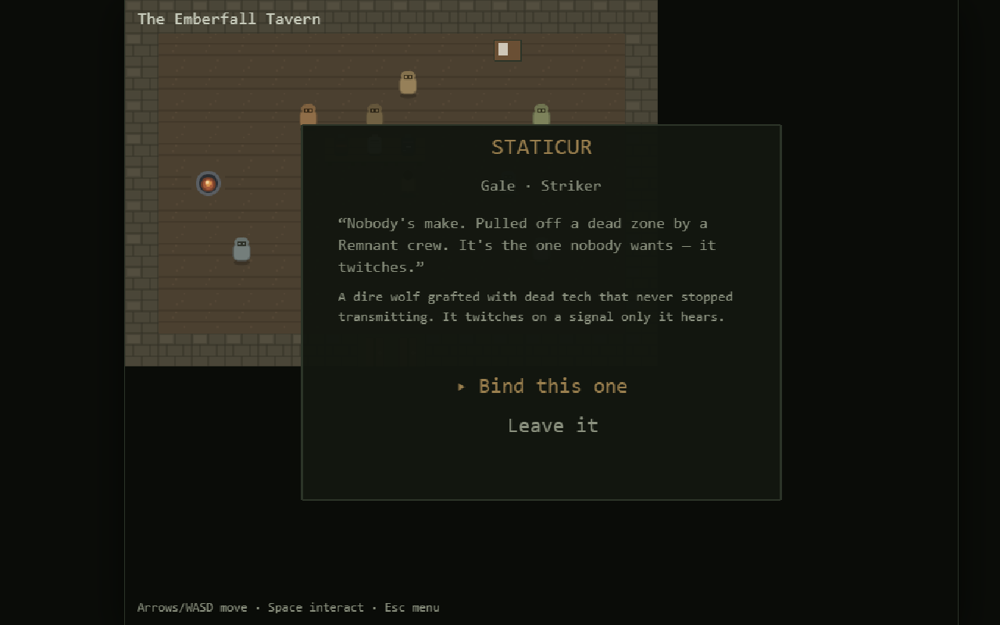

# SCORIA: What the War Left

A quiet, dark creature-collector RPG that runs in the browser, built with **Phaser 3** and **Vite** in plain JavaScript. You're a merc in the ruins after a war. You bind war-grafted creatures (numens) to cores, fight wild ones and rival corelocks, take contracts, and try to stay paid. All the art is drawn in code, so the repo has no image assets.

**Status: in development, and playable.** Phases 0 to 14 have shipped. The roadmap runs past phase 30, toward a full campaign of about 30 hours.

<p>
  
  
</p>
<p>
  
  
  
</p>

**In one minute:** I directed this game from an empty folder through phase 14 using AI coding agents. I set the world and the rules; the agents wrote the code against written build plans; every phase had to pass a headless simulation before it was tagged. The [case study](CASE_STUDY.md) covers how that worked and what went wrong along the way.

## What's in the game so far

- A persistent world of 7 maps, starting in a tavern, with a gated dungeon (the Deep Hollow).
- Turn-based battles with weaken-then-bind catching, evolution, move learning, and 12 status effects.
- A gate boss (the Barrow-King) whose numbers are locked across every phase.
- XP shared across the party, with milestone level caps and rarity-weighted encounters.
- The merc loop: five corelock duels, a currency (gilt), a field kit with tiered cores, a locker, a five-tier loot engine, Temper meters and a contract board that pays.
- Saving, with an autosave on every map change and every rest at a hearth.

## Run it

```bash
npm install
npm run dev      # Vite prints the local URL
npm run build    # static bundle in dist/
```

You need Node 18 or newer. Controls: arrow keys or WASD to move, Space or Enter to interact, Esc or M for the menu.

To run the phase simulations (no browser needed):

```bash
node scripts/sim-phase14.mjs   # prints each check and ends with ALL CHECKS PASS
```

All ten sims (`sim-phase5` to `sim-phase14`) were re-run on this public copy on 2026-11-13 with Node 22 and exit cleanly, and `npm run build` succeeds.

## How it's built

Shane directs SCORIA: the world, the creatures, the names, the tone, and every call of record. He doesn't write the code. Each phase follows the same written loop, and the documents in this repo are that loop's paper trail:

1. **Design.** The world bible, roster, names, art style and mechanics live in [`design/`](design). Shane and a chat assistant (Claude) worked them out together, and Shane's decisions are marked in them. The build agents treat these files as read-only.
2. **Plan.** Before any code is written, every phase gets a build plan ([`plans/`](plans)). Each plan sets the goal, the locked surfaces, the acceptance checks and the simulation the phase has to pass. Claude drafts the plan and Shane approves it. The order of phases and the running decisions ledger are in [`ROADMAP.md`](ROADMAP.md).
3. **Build.** An AI coding agent (Claude Code) builds the phase against its plan.
4. **Prove.** A headless simulation script ([`scripts/sim-phase*.mjs`](scripts)) exercises the phase's rules, and a live browser playtest checks the wiring the sims can't see.
5. **Report and tag.** The agent writes its own phase report ([`reports/`](reports)) before the phase is tagged. Blockers go to a blockers file instead of being guessed at.

## What's different in this public copy

This repo is a fresh snapshot without the private history. It leaves out a packaged build zip, a session handoff note and editor config. The documents had a few lines that pointed at other private projects and at local folder paths; those lines were removed. The game code is unchanged.
